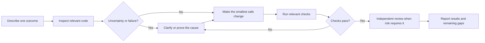

# Codex Powers

The Codex workflows I reuse, packaged as skills. Each folder under `skills/` contains a `SKILL.md` and any resources it needs, following [tstack](https://github.com/t3dotgg/tstack)'s structure.

## Skills

| Skill | Say | What it does |
| --- | --- | --- |
| [implement-outcome](skills/implement-outcome/SKILL.md) | “Use implement-outcome” | Takes a requested change through implementation and verification. |
| [build-ui](skills/build-ui/SKILL.md) | “Use build-ui” | Builds or improves UI using the project's design conventions. |
| [browser-task](skills/browser-task/SKILL.md) | “Use browser-task” | Automates a website with the installed Agent Browser CLI. |
| [fix-bug](skills/fix-bug/SKILL.md) | “Use fix-bug” | Proves the cause, applies the smallest fix, and checks it. |
| [verify-work](skills/verify-work/SKILL.md) | “Use verify-work” | Checks existing work and handles authorized independent review. |
| [write-clearly](skills/write-clearly/SKILL.md) | “Use write-clearly” | Rewrites a professional message for its audience. |
| [checkpoint-task](skills/checkpoint-task/SKILL.md) | “Use checkpoint-task” | Saves a concise checkpoint and resumes the same task. |
| [delegate-work](skills/delegate-work/SKILL.md) | “Use delegate-work” | Coordinates authorized specialists and includes optional Codex presets. |
| [trial-headroom](skills/trial-headroom/SKILL.md) | “Use trial-headroom” | Runs a measured Codex CLI compression trial. |

Expanded, copy-ready requests are in [docs/WORKFLOW.md](docs/WORKFLOW.md).

## Install

From this repository's root, copy all skills or choose individual folders:

```sh
mkdir -p ~/.agents/skills
cp -Ri skills/* ~/.agents/skills/
```

Review overwrite prompts when a destination already exists. Open a new Codex session and invoke a skill by name, for example `$fix-bug`. See [Codex skill locations](https://learn.chatgpt.com/docs/customization/overview#skills).

## Requirements

- Codex or another agent that supports `SKILL.md` folders; host-specific features are labeled in the skills.
- `browser-task`: an installed `agent-browser` CLI.
- `trial-headroom`: `uv`, a working `codex` CLI, and authorization to install and wrap it.
- `delegate-work` and independent review: a host with subagent support and access to the selected models. The bundled defaults use GPT-6.1 Sol High for implementation/review and GPT-6 Luna High for research/code mapping.

## Workflow



## Make them yours

Edit the skills to fit your work. Keep personal model choices and generic operating policy in `~/.codex/AGENTS.md`, and project constraints in each repository's `AGENTS.md`. User and project instructions override skill defaults.

The [UI template](skills/build-ui/assets/DESIGN.md) and [Codex configuration examples](skills/delegate-work/assets/codex/) ship with their owning skills. Copying the skills does not activate those presets. Use `pnpm` or `bun` for JavaScript/TypeScript package management and scripts.

Plan files, delegation, Git initialization, worktrees, commits, pushes, merges, and pull requests require explicit authorization. Keep private plans and checkpoints under `.codex/`, excluded through `.git/info/exclude`.

## License

[MIT](LICENSE)
