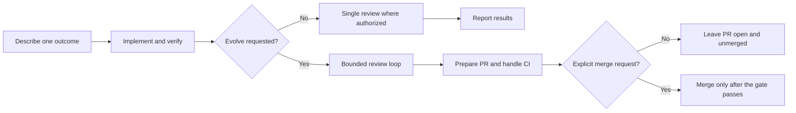

# mo-stack

The agentic workflows I reuse, packaged as skills. Each folder under `skills/` contains a `SKILL.md` and any resources it needs, following [tstack](https://github.com/t3dotgg/tstack)'s structure, with selected solo workflows adapted from [pstack](https://github.com/cursor/plugins/tree/main/pstack).

## Skills

| Skill | Say | What it does |
| --- | --- | --- |
| [implement](skills/implement/SKILL.md) | "Use implement" | Takes a requested change through implementation and verification. |
| [ui](skills/ui/SKILL.md) | "Use ui" | Builds or improves UI using the project's design conventions. |
| [browser](skills/browser/SKILL.md) | "Use browser" | Automates a website with the installed Agent Browser CLI. |
| [debug](skills/debug/SKILL.md) | "Use debug" | Proves the cause, applies the smallest fix, and checks it. |
| [verify](skills/verify/SKILL.md) | "Use verify" | Checks existing work and handles authorized independent review. |
| [review](skills/review/SKILL.md) | "Review this diff" | Investigates bugs and improvements, with prioritized evidence and precise fix handoffs. |
| [write](skills/write/SKILL.md) | "Use write" | Rewrites a professional message for its audience. |
| [checkpoint](skills/checkpoint/SKILL.md) | "Use checkpoint" | Saves a concise checkpoint and resumes the same task. |
| [delegate](skills/delegate/SKILL.md) | "Use delegate" | Coordinates authorized specialists and includes optional Claude Code and Codex presets. |
| [headroom](skills/headroom/SKILL.md) | "Use headroom" | Runs a measured context compression trial on an agent CLI. |
| [evolve](skills/evolve/SKILL.md) | "Evolve and implement this work" | Activates stronger proof, bounded independent review, and a PR left for you to merge. |
| [fullstop](skills/fullstop/SKILL.md) | "Use fullstop for this task" | Runs the shipping workflow and leaves the PR unmerged. |
| [fullsend](skills/fullsend/SKILL.md) | "Evolve and merge this work" | Runs the shipping workflow through a protected merge. |
| [reviewloop](skills/reviewloop/SKILL.md) | "Use reviewloop on this diff" | Uses one high-reasoning reviewer for up to three rounds of necessary fixes. |
| [sharpen](skills/sharpen/SKILL.md) | "Sharpen this prompt" | Improves the request and its success checks before execution. |
| [study-with-me](skills/study-with-me/SKILL.md) | "Study with me" | Gives a concise, complete explanation with architecture flowcharts, decisions, implementation, and reusable lessons. |
| [blast](skills/blast/SKILL.md) | "Check the blast radius of this change" | Proves consequential safety assumptions against real code. |
| [tdd](skills/tdd/SKILL.md) | "Use tdd for this bug" | Runs a focused regression check before and after the fix. |
| [unslop](skills/unslop/SKILL.md) | "Unslop this text" | Removes filler, vague claims, jargon, and unnecessary dash punctuation. |
| [filepr](skills/filepr/SKILL.md) | "Use filepr for this branch" | Opens a concise PR without duplicating an existing one. |
| [babysit](skills/babysit/SKILL.md) | "Babysit PR 123" | Handles CI and review feedback within the authorized scope. |

Ordinary work keeps a single independent reviewer where authorized. New subagents default to fresh conversation context and a self-contained brief; related follow-ups reuse the same agent. Evolve uses that reviewer in a bounded loop without adding an implementation team or review panel. "Evolve and implement" requests task branch commits, pushes, PR creation, and monitoring; "evolve and merge" also requests merging after the gate. Narrower instructions such as "local only" still apply.

Expanded requests ready to copy are in [docs/WORKFLOW.md](docs/WORKFLOW.md).

`review` is the shared investigation and reporting method used by `verify` and `reviewloop`. It reports by default and fixes only when requested. Ask for an independent reviewer to use fresh context; direct use in the current agent remains available. It requires no Greptile account. Detection quality against Greptile has not been benchmarked.

## Install

```sh
git clone https://github.com/moKshagna-p/mo-stack.git
cd mo-stack && ./install.sh
```

The script copies every skill to `~/.agents/skills/`, which Codex and other `SKILL.md` agents read, and links each one into `~/.claude/skills/` for Claude Code. Rerun it after `git pull` to update. Existing skills with the same names that mo-stack did not install are moved to a timestamped backup, not overwritten.

For Claude Code, it also sets `attribution` to empty in `~/.claude/settings.json`, so no session adds a `Co-Authored-By: Claude` trailer or "Generated with Claude Code" footer to commits and PRs. The original file is kept as `settings.json.mo-stack.bak`. The shipping skills follow the same rule on every host.

For another agent, copy the folders under `skills/` into its skills directory. For selected installs, also copy the [required sibling skills](docs/WORKFLOW.md#16-selected-install-dependencies). Start a new session and invoke a skill by name: `/debug` in Claude Code, `$debug` in Codex, or just ask, for example "use debug".

## Requirements

- Claude Code, Codex, or another agent that supports `SKILL.md` folders; features specific to a host are labeled in the skills.
- `browser`: an installed `agent-browser` CLI.
- `headroom`: `uv`, a working agent CLI such as `claude` or `codex`, and authorization to install and wrap it.
- PR workflows need an authenticated GitHub connection or `gh`, a writable task branch, and the repository's required checks and approvals. `babysit` uses a native watcher or the installed GitHub CLI rather than requiring paid review bots.
- `evolve`, `reviewloop`, `delegate`, and independent review: a host with subagent support. Reviews default to the host's strongest available model at high reasoning; research and code mapping can use a faster model. Name a model in your request to override.

## Workflow



## Make them yours

Edit the skills to fit your work. Keep personal model choices and generic operating policy in your agent's global instructions (`~/.claude/CLAUDE.md`, `~/.codex/AGENTS.md`, or equivalent), and project constraints in each repository's `AGENTS.md` or `CLAUDE.md`. User and project instructions override skill defaults.

The [UI template](skills/ui/assets/DESIGN.md) and [Claude Code and Codex preset examples](skills/delegate/assets/presets/) ship with their owning skills. Copying the skills does not activate those presets. Use `pnpm` or `bun` for JavaScript/TypeScript package management and scripts.

Plan files, delegation, and Git delivery require explicit authorization. An explicit shipping invocation supplies the task permissions described above; merely installing or discussing a skill does not. Keep private plans and checkpoints under `.mo-stack/`, excluded through `.git/info/exclude`.

## License

[MIT](LICENSE). Adapted skills retain upstream source links and a bundled license.
